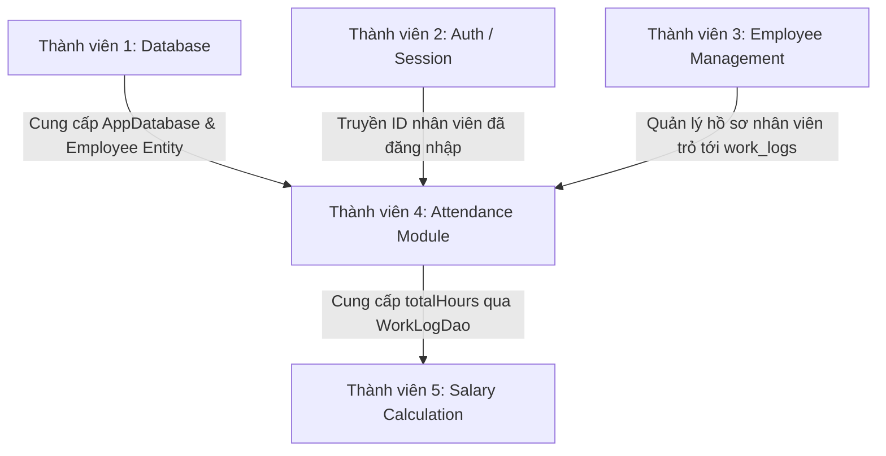

# 📋 Tổng quan chi tiết: Thành viên 4 - Attendance & WorkLog Module

Tài liệu này cung cấp breakdown toàn diện về cấu trúc, chức năng và mối liên kết của module **Chấm công & Nhật ký làm việc (Attendance & WorkLog)** dành cho Nhân viên.

---

## 📂 Danh sách các file trong Module & Chức năng chính

### 1. Tầng dữ liệu (Data & Persistence Layer)
* **`WorkLogEntity.kt`** ([WorkLogEntity.kt](file:///Users/duyphuc/AndroidStudioProjects/BaiThucHanhAndroid/app/src/main/java/com/example/thuchanhandroid/data/db/entity/WorkLogEntity.kt))
  * **Chức năng:** Định nghĩa cấu trúc bảng `work_logs` trong Room Database.
  * **Điểm nổi bật:** Có thiết lập **Unique Index** trên cặp `(employeeId, workDate)` để ngăn chặn việc nhân viên check-in nhiều lần trong cùng một ngày ở tầng cơ sở dữ liệu.
  * **Các trường chính:** `id`, `employeeId`, `workDate`, `checkInTime`, `checkOutTime`, `totalHours`, `status` (`"WORKING"`, `"COMPLETED"`).

* **`WorkLogDao.kt`** ([WorkLogDao.kt](file:///Users/duyphuc/AndroidStudioProjects/BaiThucHanhAndroid/app/src/main/java/com/example/thuchanhandroid/data/db/dao/WorkLogDao.kt))
  * **Chức năng:** Cung cấp các câu lệnh SQL / Room Queries thao tác với bảng `work_logs`.
  * **Các hàm chính:**
    * `insert()` / `update()`: Lưu và cập nhật nhật ký chấm công.
    * `getWorkLogByDate()`: Lấy thông tin chấm công của nhân viên theo ngày cụ thể.
    * `getWorkLogsForEmployee()`: Trả về `Flow<List<WorkLogEntity>>` để cập nhật danh sách lịch sử theo thời gian thực (Reactive).
    * `getTotalHoursForMonth()`: Tính tổng số giờ làm việc trong tháng (hỗ trợ cho module tính lương).

---

### 2. Tầng nghiệp vụ (Business Logic & ViewModel)
* **`AttendanceViewModel.kt`** ([AttendanceViewModel.kt](file:///Users/duyphuc/AndroidStudioProjects/BaiThucHanhAndroid/app/src/main/java/com/example/thuchanhandroid/ui/attendance/AttendanceViewModel.kt))
  * **Chức năng:** Quản lý State và xử lý logic nghiệp vụ chấm công, đảm bảo tính an toàn luồng dữ liệu (Coroutines Dispatchers.IO).
  * **Các chức năng chính:**
    * `checkIn(employeeId)`: Kiểm tra xem hôm nay đã check-in chưa. Nếu chưa $\rightarrow$ tạo bản ghi mới với trạng thái `"WORKING"`.
    * `checkOut(employeeId)`: Kiểm tra điều kiện (đã check-in chưa, đã check-out chưa). Thực hiện **Data Validation**: thời gian check-out phải lớn hơn check-in. Tự động tính `totalHours` và chuyển trạng thái thành `"COMPLETED"`.

---

### 3. Tầng giao diện (UI & Presentation Layer)
* **`AttendanceActivity.kt`** ([AttendanceActivity.kt](file:///Users/duyphuc/AndroidStudioProjects/BaiThucHanhAndroid/app/src/main/java/com/example/thuchanhandroid/ui/attendance/AttendanceActivity.kt))
  * **Chức năng:** Màn hình chính (Dashboard Chấm công) của nhân viên.
  * **Thành phần:**
    * Nút **Check-In** và **Check-Out**.
    * `RecyclerView` hiển thị danh sách lịch sử chấm công cập nhật tự động qua Flow.
    * Hiển thị thông báo Toast theo thời gian thực kết quả thao tác.

* **`WorkLogAdapter.kt`** ([WorkLogAdapter.kt](file:///Users/duyphuc/AndroidStudioProjects/BaiThucHanhAndroid/app/src/main/java/com/example/thuchanhandroid/ui/attendance/WorkLogAdapter.kt))
  * **Chức năng:** RecyclerView Adapter đổ dữ liệu từng dòng nhật ký làm việc (`WorkLogEntity`) lên giao diện.

* **Layout XML:**
  * [`activity_attendance.xml`](file:///Users/duyphuc/AndroidStudioProjects/BaiThucHanhAndroid/app/src/main/res/layout/activity_attendance.xml): Giao diện màn hình chấm công chính.
  * [`item_work_log.xml`](file:///Users/duyphuc/AndroidStudioProjects/BaiThucHanhAndroid/app/src/main/res/layout/item_work_log.xml): Giao diện từng item dòng lịch sử (Ngày, giờ vào, giờ ra, tổng giờ, trạng thái).

---

## 🔗 Mối liên kết với các thành viên khác trong nhóm

1. **Liên kết với Thành viên 1 (Database Architect):**
   * Sử dụng chung `AppDatabase` và liên kết khóa ngoại với bảng `employees` (`employeeId`).
2. **Liên kết với Thành viên 2 (Auth & Session):**
   * Biến `currentEmployeeId` trong `AttendanceActivity` sẽ nhận giá trị từ phiên đăng nhập (`SharedPreferences` / Intent) do Thành viên 2 cung cấp sau khi nhân viên đăng nhập thành công.
3. **Liên kết với Thành viên 3 (Employee Management):**
   * Đảm bảo rằng mỗi `employeeId` chấm công phải tương ứng với một nhân viên hợp lệ trong hệ thống quản lý nhân sự.
4. **Liên kết với Thành viên 5 (Salary Calculation):**
   * Hàm `getTotalHoursForMonth()` trong `WorkLogDao` chính là chiếc cầu nối quan trọng để Thành viên 5 lấy tổng số giờ làm việc trong tháng nhân với `hourlyRate` nhằm tính toán bảng lương (`Salary`) cho nhân viên.
